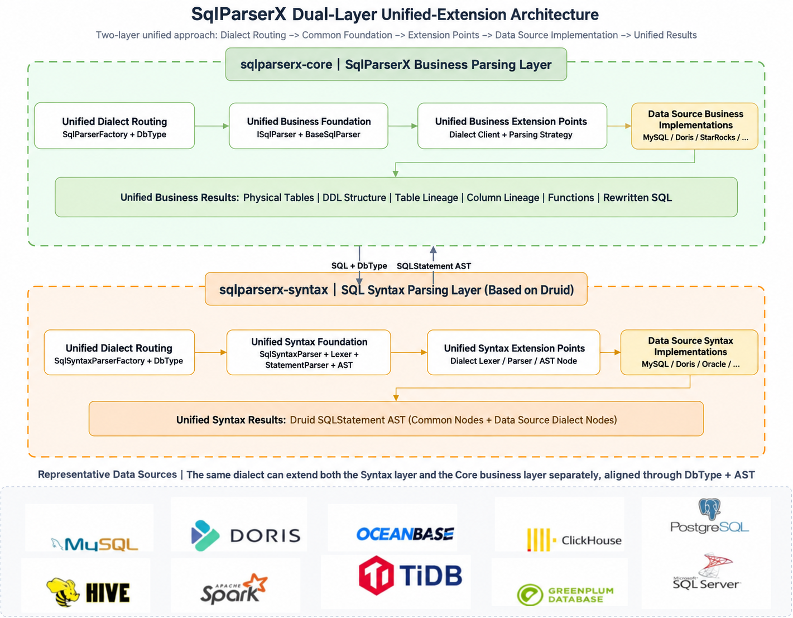

# SqlParserX


> **English** | [简体中文](README_zh-CN.md)

[](LICENSE)


## Introduction

> A multi-database SQL parsing engine and toolkit: table parsing, table/column lineage, function extraction, SQL splitting, row-level permission rewriting, with a Java Module, Web service and visualization frontend.

SqlParserX is a "**Druid syntax parsing layer + SqlParserX business parsing layer**" SQL parsing middleware.

SqlParserX originated from practical work on multi-datasource SQL parsing, AST unification and reusable business parsing. It gradually evolved from an internal parsing refactoring into an independent two-layer SQL parsing engine. For the project background, internal refactoring journey and design rationale, see the technical blog: [The Origin and Internal Refactoring of SqlParserX](docs/blogs/20260928：SqlParserX的诞生起源背景%26内部改造.md).

## Core Capabilities

| Problem | SqlParserX Solution |
|---|---|
| Different SQL dialects across databases | Unified AST through Druid dialect parsing and `DbType` routing |
| Real tables and DDL structure hidden in SQL text | **Table parsing** (main tables, real tables, CTEs, subqueries) and **CREATE TABLE parsing** (columns, comments, partitions, buckets, keys, properties) |
| Data processing lineage impossible to trace | **Table lineage** and **column lineage**, covering JOIN, UNION, subqueries, aggregates, CASE, window functions and CTEs |
| Want to know which functions a SQL uses | **Function extraction** of function names used in the SQL |
| Multi-statement scripts hard to process one by one | **Multi-statement parsing**, **SQL splitting** and **syntax validation** |
| Permission predicates manually stitched and error-prone | **Row-level permission rewriting**, injecting permission predicates into query/insert/update SQL |
| Dynamic variables in SQL hard to parameterize | **Parameter extraction & prepared-statement rewriting**, parsing `${var}` into JDBC `?` placeholders |
| Parsing capability hard to integrate into existing systems | Java Module, Web service and visualization frontend |

SqlParserX's common parsing capabilities are built around the following core scenarios. For detailed support of each capability, see the [common parsing capability docs](docs/02、SQL业务层解析能力支撑情况/能力支持情况/通用解析能力/表解析支持情况.md):

## Quick Examples

### Maven dependency

```xml
<dependency>
    <groupId>com.dtstack</groupId>
    <artifactId>sqlparserx-core</artifactId>
    <version>1.0-SNAPSHOT</version>
</dependency>
```

### 1. Table Lineage

```java
ISqlParser parser = SqlParserFactory.getSqlParser(SqlParserDataSourceType.MYSQL);

TableLineageResult result = parser.parseTableLineages(
        "INSERT INTO db1.table1 " +
        "SELECT a.id, b.name FROM db2.table2 a JOIN db3.table3 b ON a.id = b.id");
result.getTableLineages().forEach(System.out::println);
```

Output:

```text
Target Tables:
    db1.table1
Source Tables:
    db2.table2
    db3.table3
```

### 2. Column Lineage

```java
ColumnLineageResult result = parser.parseColumnLineages(
        "CREATE TABLE db1.summary AS " +
        "SELECT u.id AS user_id, SUM(o.amount) AS total_amount " +
        "FROM db1.users u JOIN db1.orders o ON u.id = o.user_id " +
        "GROUP BY u.id",
        tableColumnsMap /* optional: real columns for `SELECT *` expansion */);

result.printColumnLineage();
```

Output:

```text
db1.users.id          -> db1.summary.user_id
db1.users.id, db1.orders.amount -> db1.summary.total_amount
```

Column lineage traces each target column back to its source columns through expressions, aggregates, `CASE`, window functions, `*` expansion and CTEs.

### 3. SQL Parameter Extraction & Prepared-Statement Compilation

SQL scripts often contain dynamic variables such as `${bizdate}`. SqlParserX provides two core entry points: **parameter extraction** (`parseParameterSql`, resolving variables with their positions and types) and **prepared-statement rewriting** (`buildSqlByPrepareCompile`, replacing `${var}` with `?` placeholders and returning the ordered parameter values):

```java
ISqlParser parser = SqlParserFactory.getSqlParser(SqlParserDataSourceType.MYSQL);

String sql = "SELECT * FROM db1.table1 WHERE dt = '${bizdate}' AND region = '${region}'";

// 1. Extract dynamic variables (name, required flag, default value, bound table column, ...)
ParseParameterResult paramResult = parser.parseParameterSql(sql, false, null);
paramResult.getInputParams().forEach(p ->
        System.out.println(p.getName() + " / " + p.getDataType() + " / " + p.getSqlPart()));

// 2. Compile to a prepared statement with ordered parameter values
Map<String, Object> inParams = new HashMap<>();
inParams.put("bizdate", "20240101");
inParams.put("region", "hangzhou");

PrepareCompileResult compileResult = parser.buildSqlByPrepareCompile(sql, inParams, columns);
compileResult.getBeautifulSql();   // SELECT * FROM db1.table1 WHERE dt = ? AND region = ?
compileResult.getInputFields();    // [20240101, hangzhou]
```

Output:

```text
bizdate / ... / dt = '${bizdate}'
region  / ... / region = '${region}'

SELECT * FROM db1.table1 WHERE dt = ? AND region = ?
[20240101, hangzhou]
```

See [`sqlparserx-core/README.md`](sqlparserx-engine/sqlparserx-core/README.md) for the complete runnable example.

### Other Capabilities

| Capability | Description |
|---|---|
| SQL type parsing | Identifying SQL statement types for routing and validation scenarios |
| SQL splitting | Multi-statement script splitting with Druid-native strategies |

For detailed support of each capability per datasource, see the [common parsing capability docs](docs/02、SQL业务层解析能力支撑情况/能力支持情况/通用解析能力/表解析支持情况.md) series and the [Support Datasource](#support-datasource) section.

## Architecture

SqlParserX adopts a layered, decoupled design with clear responsibilities per layer:



```text
Access: sqlparserx-web (REST) / sqlparserx-ui
                 │ unified ISqlParser contract
Business layer:  sqlparserx-core
                 │ SQL + DbType / SQLStatement AST
Syntax layer:    sqlparserx-syntax (Druid 1.2.28)
```

**Business-layer internals**: `SqlParserFactory` (selects the dialect by Druid `DbType`) → `ISqlParser` (unified contract) → `BaseSqlParser` (dispatches AST to Clients) → dialect implementations (override table/lineage parsing as needed). For quick usage examples, see the [Core Capabilities](#core-capabilities) section above.

| Module | Layer | Description | Technology |
|---|---|---|---|
| `sqlparserx-syntax` | Syntax parsing | SQL-to-AST, multi-statement parsing, SQL splitting and Druid dialect extensions | Java 8 + Druid 1.2.28 |
| `sqlparserx-core` | Business parsing | Tables, lineage, CREATE TABLE, functions and SQL rewriting | Java 8 + `sqlparserx-syntax` |
| `sqlparserx-web` | Access layer | Spring Boot REST service, providing HTTP API and hosting frontend assets | Spring Boot 2.3.12 + Java 8 |
| `sqlparserx-ui` | Access layer | Frontend toolkit (lineage visualization, parsing/validation/splitting tests) | Vue 2.7 + Element UI 2.x + Vite 5 + ECharts 5 |

### Unified contract `ISqlParser`

The unified business-layer contract implemented by all dialect parsers:

```java
ParseTableResult   parseTables(String sql);                                          // table parsing
ParseCreateTableResult parseCreateTable(String sql);                                 // CREATE TABLE parsing
ColumnLineageResult parseColumnLineages(String sql, Map<String,List<Column>> meta);  // column lineage
TableLineageResult parseTableLineages(String sql);                                   // table lineage
Set<String>        parseFunction(String sql);                                        // function extraction
String             getRowLevelPermissionSql(String sql, List<...> permissionParams); // row-level permission
ParseParameterResult parseParameterSql(String sql, Boolean isIgnoreSyntaxCheck,
        Map<String, List<DataTypeColumn>> tableColumnsMap);                          // variable parameter parsing (config phase)
PrepareCompileResult buildSqlByPrepareCompile(String sql, Map<String, Object> inParams,
        Map<String, ParamInfo> columns);                                             // prepared-statement rewriting (runtime phase)
```

### Layered extension model

Dialect implementations should extend `BaseSqlParser` and only override the corresponding Client when there is a real difference. For example, when the syntax layer adds `MySqlRenameTableStatement` that the generic `ParseTableClient` does not handle, you can define a `MySqlParseTableClient` under the `parser.mysql` package that extends and overrides `parseTables`. See [`sqlparserx-core/README.md`](sqlparserx-engine/sqlparserx-core/README.md) for details.

## Support Datasource

| Datasource | Business parsing documentation | Syntax parsing documentation | Support description |
|---|---|---|---|
| MySQL | [Business](docs/02、SQL业务层解析能力支撑情况/能力支持情况/datasource/mysql/SQL业务解析支持情况.md) | [Syntax](docs/02、SQL业务层解析能力支撑情况/能力支持情况/datasource/mysql/SQL语法解析支持情况.md) | Priority support; enhanced RENAME TABLE handling. |
| Doris | [Business](docs/02、SQL业务层解析能力支撑情况/能力支持情况/datasource/doris/SQL业务解析支持情况.md) | [Syntax](docs/02、SQL业务层解析能力支撑情况/能力支持情况/datasource/doris/SQL语法解析支持情况.md) | Strong support: CREATE TABLE, table/column lineage, case matching and CTE forward references, with dedicated tests. |
| StarRocks | [Business](docs/02、SQL业务层解析能力支撑情况/能力支持情况/datasource/starrocks/SQL业务解析支持情况.md) | [Syntax](docs/02、SQL业务层解析能力支撑情况/能力支持情况/datasource/starrocks/SQL语法解析支持情况.md) | Priority support: DISTRIBUTED BY, DUPLICATE KEY / AGGREGATE KEY DDL parsing. |
| Hive | [Business](docs/02、SQL业务层解析能力支撑情况/能力支持情况/README.md) | [Syntax](docs/01、SQL语法层解析能力支撑情况/Druid版本与SQL语法支持情况.md) | Standard support: registered parser, mostly reuses Base implementation. |
| ClickHouse | [Business](docs/02、SQL业务层解析能力支撑情况/能力支持情况/README.md) | [Syntax](docs/01、SQL语法层解析能力支撑情况/Druid版本与SQL语法支持情况.md) | Standard support: registered parser, mostly reuses Base implementation. |
| Oracle | [Business](docs/02、SQL业务层解析能力支撑情况/能力支持情况/README.md) | [Syntax](docs/01、SQL语法层解析能力支撑情况/Druid版本与SQL语法支持情况.md) | Standard support: registered parser, mostly reuses Base implementation. |
| DM | [Business](docs/02、SQL业务层解析能力支撑情况/能力支持情况/README.md) | [Syntax](docs/01、SQL语法层解析能力支撑情况/Druid版本与SQL语法支持情况.md) | Standard support: registered parser, mostly reuses Base implementation. |
| OceanBase | [Business](docs/02、SQL业务层解析能力支撑情况/能力支持情况/README.md) | [Syntax](docs/01、SQL语法层解析能力支撑情况/Druid版本与SQL语法支持情况.md) | Standard support: registered parser, mostly reuses Base implementation. |
| OceanBase (Oracle mode) | [Business](docs/02、SQL业务层解析能力支撑情况/能力支持情况/README.md) | [Syntax](docs/01、SQL语法层解析能力支撑情况/Druid版本与SQL语法支持情况.md) | Standard support: registered parser, mostly reuses Base implementation. |
| PostgreSQL | [Business](docs/02、SQL业务层解析能力支撑情况/能力支持情况/README.md) | [Syntax](docs/01、SQL语法层解析能力支撑情况/Druid版本与SQL语法支持情况.md) | Standard support: registered parser, mostly reuses Base implementation. |
| Greenplum | [Business](docs/02、SQL业务层解析能力支撑情况/能力支持情况/README.md) | [Syntax](docs/01、SQL语法层解析能力支撑情况/Druid版本与SQL语法支持情况.md) | Standard support: registered parser, mostly reuses Base implementation. |
| Spark | [Business](docs/02、SQL业务层解析能力支撑情况/能力支持情况/README.md) | [Syntax](docs/01、SQL语法层解析能力支撑情况/Druid版本与SQL语法支持情况.md) | Standard support: registered parser, mostly reuses Base implementation. |
| SQL Server | [Business](docs/02、SQL业务层解析能力支撑情况/能力支持情况/README.md) | [Syntax](docs/01、SQL语法层解析能力支撑情况/Druid版本与SQL语法支持情况.md) | Standard support: registered parser, mostly reuses Base implementation. |
| TiDB | [Business](docs/02、SQL业务层解析能力支撑情况/能力支持情况/README.md) | [Syntax](docs/01、SQL语法层解析能力支撑情况/Druid版本与SQL语法支持情况.md) | Standard support: registered parser, mostly reuses Base implementation. |
| Trino | [Business](docs/02、SQL业务层解析能力支撑情况/能力支持情况/README.md) | [Syntax](docs/01、SQL语法层解析能力支撑情况/Druid版本与SQL语法支持情况.md) | Standard support: registered parser, mostly reuses Base implementation. |

> Note: MySQL, Doris and StarRocks have dedicated datasource docs; the table above only lists officially registered dialects in SqlParserX Core. The Web `/api/datasource/types` keeps source-level validation with Core's `SqlParserFactory`; Web-only compatibility mappings are not included in the support list.

## Parsing Capability Support

SqlParserX capability support requires checking both "whether the syntax layer produces the correct AST" and "whether the business layer outputs stable results". Current capability docs are maintained at the following levels:

| Documentation | Scope |
|---|---|
| [SQL syntax parsing support](docs/01、SQL语法层解析能力支撑情况/Druid版本与SQL语法支持情况.md) | Druid version, official dialect grammar range and SqlParserX syntax-layer adaptation boundary |
| [SQL business parsing support](docs/02、SQL业务层解析能力支撑情况/能力支持情况/README.md) | Datasource matrix, syntax/business two-layer adaptation, common parsing capabilities and dedicated doc index |
| [Module dependency design](docs/02、SQL业务层解析能力支撑情况/模块依赖包引用结构设计.md) | Dependency boundaries of `sqlparserx-syntax`, `sqlparserx-core` and `sqlparserx-engine` |
| [Architecture design](docs/架构设计/架构设计.md) | Unified extension model and collaboration boundary of the syntax and business layers |

Current core parsing capabilities:

| Capability | Description |
|---|---|
| Table parsing | Main tables, real tables, CTEs, subqueries and multiple DML/DDL scenarios |
| CREATE TABLE parsing | Table, columns, comments, partitions, buckets, keys and properties |
| Column lineage | INSERT/CTAS, JOIN, UNION, aggregates, CASE, window functions, `*` expansion and CTEs |
| Table lineage | Target tables, source tables and their relations, with CTE forward-reference inference |
| Function extraction | Function names used in the SQL |
| SQL splitting | Multi-statement script splitting with Druid-native strategies |
| SQL rewriting | Row-level permission predicate injection and related SQL filtering strategies |

## Project Structure

```
SqlParserX
├── sqlparserx-engine/          # SQL parsing engine aggregate parent module (packaging=pom)
│   ├── sqlparserx-syntax/      # SQL syntax parsing layer (Java 8 + Druid)
│   └── sqlparserx-core/        # SQL business parsing layer (Java 8)
│       └── src/main/java/com/dtstack/sqlparserx/core
│       ├── parser/             # factory, unified interface, base class and 15 dialect implementations
│       │   ├── base/           # base implementations for tables/lineage/parameters/filtering
│       │   ├── mysql/ hive/ doris/ starrocks/ ...   # dialect extensions
│       │   └── ...
│       ├── select/             # select tracing engine (shared by column/table lineage)
│       ├── enums/              # parsing strategy, matching strategy and column type enums
│       └── utils/              # SQL splitting, table source parsing and other utilities
├── sqlparserx-web/             # Spring Boot REST service (:8888)
├── sqlparserx-ui/              # Vue2 + Vite frontend toolkit
├── bin/                        # start/stop scripts (centos-sqlparserx.sh / base.sh)
├── conf/                       # external configuration: application.properties, logback.xml, static frontend assets
└── assembly.xml                # directory-style deployment packaging descriptor
```

## Known Limitations

- Parameter parsing (`parseParameterSql` / `buildSqlByPrepareCompile`) and `filterSortSelectField` are placeholder implementations at the base layer (returning empty); they are reserved capabilities without concrete logic yet.
- Maven surefire in `sqlparserx-core` defaults to `skipTests=true`; CI builds do not run tests by default.
- The frontend `sqlparserx-ui/README.md` contains default Vite template text; the actual stack is Vue 2.7 + Element UI 2.x.

## Questions

[FAQ Reference](docs/02、SQL业务层解析能力支撑情况/能力支持情况/README.md). For usage questions, bugs or support requests, please open an issue with the datasource type, SQL sample, expected result and actual result, and we will follow up promptly.

Recommended references for common questions:

- [Architecture design](docs/架构设计/架构设计.md)
- [SQL syntax parsing support](docs/01、SQL语法层解析能力支撑情况/Druid版本与SQL语法支持情况.md)
- [SQL business parsing support](docs/02、SQL业务层解析能力支撑情况/能力支持情况/README.md)

## Contribution

Contributions of any form are welcome: bug fixes, new dialect support, lineage parsing enhancements and documentation improvements.

- **Open an Issue**: if you find a bug or want a new capability, please open an issue first with reproduction steps and expected behavior.
- **Submit a PR**: fork the repository, develop on a feature branch (e.g. `feat_1.0.x_x`), follow the existing layered extension model (add dialect implementations or override Clients under the `parser` package), add corresponding test cases, then open a pull request.
- **Development conventions**: keep the core library Java 8 compatible; prefer extending `BaseSqlParser` for new dialect implementations and only override methods when necessary; test cases can follow the suite organization in `AllTestsSuite`.

Before submitting a pull request, please read the [Contributing Guide](docs/02、SQL业务层解析能力支撑情况/标准迭代维护扩展文档/SqlParserX解析能力标准迭代维护扩展指南.md) and the architecture, module dependency and capability support docs to make sure new logic is placed in the correct syntax or business layer.

## Contributor

Thanks to all contributors of code, tests, documentation and issue feedback. New contributors can join the project collaboration by opening issues or pull requests.

[View project contributors and commit history](https://gitlab.prod.dtstack.cn/changlu/SqlParserX/-/graphs/master)

## License

SqlParserX is licensed under the [Apache License 2.0](LICENSE). See [Apache License 2.0](https://www.apache.org/licenses/LICENSE-2.0) for details.
