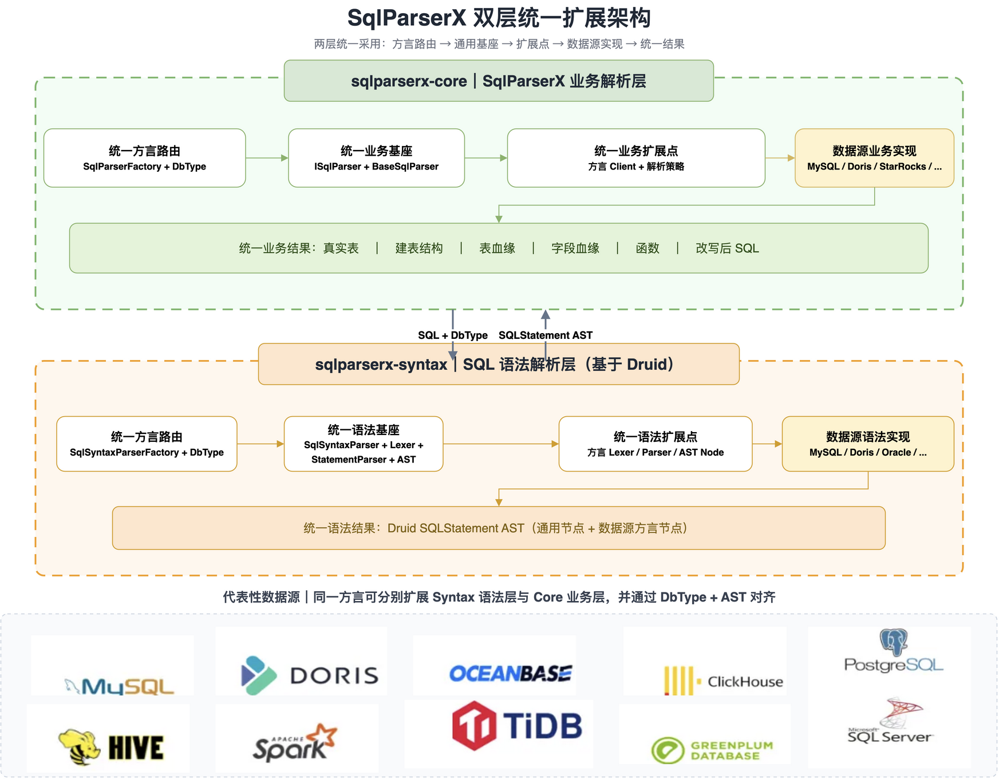

> [English](README.md) | **简体中文**

[](LICENSE)


## 介绍

> 多数据库方言 SQL 解析引擎与工具集：表解析、表/字段血缘解析、函数解析、SQL 切分、行级权限 SQL 过滤，并提供 Java Module、Web 服务与可视化前端。

SqlParserX 是一套「**Druid 语法解析层 + SqlParserX 业务解析层**」的 SQL 解析中间件。

SqlParserX 起源于对多数据源 SQL 解析、AST 统一和业务解析复用问题的持续实践，项目在内部解析能力改造的基础上逐步沉淀为独立的双层 SQL 解析引擎。关于项目为什么诞生、内部改造过程及设计思考，可阅读技术博客：[SqlParserX 的诞生起源背景 & 内部改造](docs/blogs/20260928：SqlParserX的诞生起源背景%26内部改造.md)。

## 核心提供能力

| 使用问题 | SqlParserX 解决方式 |
|---|---|
| 不同数据库 SQL 方言不一致 | 通过 Druid 方言解析和 `DbType` 路由统一生成 AST |
| 只拿到 SQL 文本，难以识别真实表和建表结构 | 提供**表解析**（主表、真实表、CTE、子查询）和**建表解析**（字段、注释、分区、分桶、Key、properties） |
| 数据加工链路无法追溯 | 提供**表血缘**和**字段血缘**，覆盖 JOIN、UNION、子查询、聚合、CASE、窗口函数和 CTE |
| 想了解 SQL 用到了哪些函数 | 提供**函数解析**，提取 SQL 中使用的函数名称 |
| 多条 SQL 脚本难以逐条处理 | 提供**多语句解析**、**SQL 切分**和**语法校验** |
| 权限条件需要手工拼接且容易出错 | 提供**行级权限改写**，向查询、写入和更新 SQL 注入行级权限条件 |
| SQL 中的动态变量难以参数化 | 提供**参数提取与预编译改写**，解析 `${变量}` 并改写为 JDBC `?` 占位符 |
| 解析能力难以接入现有系统或工具 | 提供 Java Module、Web 服务和可视化前端 |

SqlParserX 的通用解析能力围绕以下核心场景构建，各能力的详细支持情况见 [通用解析能力文档](docs/02、SQL业务层解析能力支撑情况/能力支持情况/通用解析能力/表解析支持情况.md)：

## 快速示例

### 引入pom依赖

```xml
<dependency>
    <groupId>com.dtstack</groupId>
    <artifactId>sqlparserx-core</artifactId>
    <version>1.0-SNAPSHOT</version>
</dependency>
```

### 1. 表血缘

```java
ISqlParser parser = SqlParserFactory.getSqlParser(SqlParserDataSourceType.MYSQL);

TableLineageResult result = parser.parseTableLineages(
        "INSERT INTO db1.table1 " +
        "SELECT a.id, b.name FROM db2.table2 a JOIN db3.table3 b ON a.id = b.id");
result.getTableLineages().forEach(System.out::println);
```

输出：

```text
Target Tables:
    db1.table1
Source Tables:
    db2.table2
    db3.table3
```

### 2. 字段血缘

```java
ColumnLineageResult result = parser.parseColumnLineages(
        "CREATE TABLE db1.summary AS " +
        "SELECT u.id AS user_id, SUM(o.amount) AS total_amount " +
        "FROM db1.users u JOIN db1.orders o ON u.id = o.user_id " +
        "GROUP BY u.id",
        tableColumnsMap /* 可选：传入真实表字段信息，用于 `SELECT *` 展开 */);

result.printColumnLineage();
```

输出：

```text
db1.users.id          -> db1.summary.user_id
db1.users.id, db1.orders.amount -> db1.summary.total_amount
```

字段血缘将每个目标字段追溯到其来源字段，覆盖表达式、聚合、`CASE`、窗口函数、`*` 展开和 CTE。

### 3. SQL 参数提取与预编译

SQL 脚本中常包含 `${bizdate}` 这类动态变量。SqlParserX 提供两个核心入口：**参数提取**（`parseParameterSql`，解析脚本中的变量及其位置、类型信息）与**预编译改写**（`buildSqlByPrepareCompile`，将 `${var}` 替换为预编译占位符并生成参数值列表）：

```java
ISqlParser parser = SqlParserFactory.getSqlParser(SqlParserDataSourceType.MYSQL);

String sql = "SELECT * FROM db1.table1 WHERE dt = '${bizdate}' AND region = '${region}'";

// 1、参数提取：解析 SQL 中的动态变量（名称、是否必填、默认值、绑定的表字段等）
ParseParameterResult paramResult = parser.parseParameterSql(sql, false, null);
paramResult.getInputParams().forEach(p ->
        System.out.println(p.getName() + " / " + p.getDataType() + " / " + p.getSqlPart()));

// 2、预编译：传入参数值，得到 ? 占位符 SQL 与按序参数列表
Map<String, Object> inParams = new HashMap<>();
inParams.put("bizdate", "20240101");
inParams.put("region", "hangzhou");

PrepareCompileResult compileResult = parser.buildSqlByPrepareCompile(sql, inParams, columns);
compileResult.getBeautifulSql();   // SELECT * FROM db1.table1 WHERE dt = ? AND region = ?
compileResult.getInputFields();    // [20240101, hangzhou]
```

输出：

```text
bizdate / ... / dt = '${bizdate}'
region  / ... / region = '${region}'

SELECT * FROM db1.table1 WHERE dt = ? AND region = ?
[20240101, hangzhou]
```

完整可运行示例见 [`sqlparserx-core/README.md`](sqlparserx-engine/sqlparserx-core/README.md)。

### 其他能力

| 能力 | 说明 |
|---|---|
| SQL 类型解析 | 识别 SQL 语句类型，支撑路由与校验场景 |
| SQL 切分 | 支持多语句脚本切分及 Druid 原生切分策略 |

各能力在各数据源下的详细支持情况，见 [通用解析能力文档](docs/02、SQL业务层解析能力支撑情况/能力支持情况/通用解析能力/表解析支持情况.md) 系列与 [数据源支持](#support-datasource数据源支持) 章节。

## 架构

SqlParserX 采用分层解耦设计，各层职责清晰、可独立演进：



> Draw.io 源文件与完整设计说明见：[双层架构设计](docs/架构设计/架构设计.md)｜[SqlParserX两层架构.drawio](docs/架构设计/SqlParserX两层架构.drawio)。

```
┌──────────────────────────────────────────────────────────┐
│  能力出口层                                                │
│  sqlparserx-web (REST :8888) │ sqlparserx-ui (Vue + ECharts) │
│  sqlparserx-ui (Vue2 + ECharts 血缘可视化)                  │
└───────────────────────────┬──────────────────────────────┘
                            │ 依赖统一契约 ISqlParser
┌───────────────────────────▼──────────────────────────────┐
│  解析业务层（本项目自研）  sqlparserx-core                  │
│  工厂 → 接口 → 基类 → 方言扩展                              │
│  表解析 / 血缘 / 建表 / 函数 / 切分 / 行级权限过滤            │
└───────────────────────────┬──────────────────────────────┘
                            │ SQL + DbType / SQLStatement AST
┌───────────────────────────▼──────────────────────────────┐
│  语法解析层  sqlparserx-syntax                              │
│  统一语法 API / Druid 1.2.28 / 方言 Lexer·Parser·AST 扩展    │
└──────────────────────────────────────────────────────────┘
```

**业务层内部分层**：`SqlParserFactory`（按 Druid `DbType` 选择方言）→ `ISqlParser`（统一契约）→ `BaseSqlParser`（AST 分发到各 Client）→ 各方言实现（按需重写表/血缘解析）。各能力的快速使用示例见上方 [核心能力](#核心能力) 章节。

| 模块 | 层次 | 说明 | 技术栈 |
|---|---|---|---|
| `sqlparserx-syntax` | 语法解析层 | SQL→AST、多语句解析、SQL 切分及 Druid 方言语法扩展 | Java 8 + Druid 官方 1.2.28 |
| `sqlparserx-core` | 解析业务层 | 表、血缘、建表、函数和 SQL 改写等业务解析能力 | Java 8 + `sqlparserx-syntax` |
| `sqlparserx-web` | 能力出口层 | Spring Boot REST 服务，提供 HTTP API 并托管前端静态资源 | Spring Boot 2.3.12 + Java 8 |
| `sqlparserx-ui` | 能力出口层 | 前端工具集（血缘可视化、解析/校验/切分测试） | Vue 2.7 + Element UI 2.x + Vite 5 + ECharts 5 |

### 核心契约 `ISqlParser`

业务层对外统一契约，所有方言解析器均实现该接口：

```java
ParseTableResult   parseTables(String sql);                                          // 表解析
ParseCreateTableResult parseCreateTable(String sql);                                 // 建表解析
ColumnLineageResult parseColumnLineages(String sql, Map<String,List<Column>> meta);  // 字段血缘
TableLineageResult parseTableLineages(String sql);                                   // 表血缘
Set<String>        parseFunction(String sql);                                        // 函数解析
String             getRowLevelPermissionSql(String sql, List<...> permissionParams); // 行级权限过滤
ParseParameterResult parseParameterSql(String sql, Boolean isIgnoreSyntaxCheck,
        Map<String, List<DataTypeColumn>> tableColumnsMap);                          // 变量参数解析（配置期）
PrepareCompileResult buildSqlByPrepareCompile(String sql, Map<String, Object> inParams,
        Map<String, ParamInfo> columns);                                             // 预编译改写（运行期）
```

### 分层扩展模式

方言实现优先继承 `BaseSqlParser`，仅在确有差异时重写对应 Client。例如当 Druid 语法层新增了 `MySqlRenameTableStatement`，而通用 `ParseTableClient` 未处理时，可在 `parser.mysql` 包下自定义 `MySqlParseTableClient` 继承并重写 `parseTables`。详见 [`sqlparserx-core/README.md`](sqlparserx-engine/sqlparserx-core/README.md)。

## Support Datasource（数据源支持）

| 数据源名称 | 业务解析文档 | 语法解析文档 | 支持说明 |
|---|---|---|---|
| MySQL | [业务解析文档](docs/02、SQL业务层解析能力支撑情况/能力支持情况/datasource/mysql/SQL业务解析支持情况.md) | [语法解析文档](docs/02、SQL业务层解析能力支撑情况/能力支持情况/datasource/mysql/SQL语法解析支持情况.md) | 重点支持：补充 RENAME TABLE 真实表识别，其余能力主要复用通用实现。 |
| Doris | [业务解析文档](docs/02、SQL业务层解析能力支撑情况/能力支持情况/datasource/doris/SQL业务解析支持情况.md) | [语法解析文档](docs/02、SQL业务层解析能力支撑情况/能力支持情况/datasource/doris/SQL语法解析支持情况.md) | 重度支持：覆盖建表、表/字段血缘、大小写匹配和 CTE 前向引用，并有专项测试。 |
| StarRocks | [业务解析文档](docs/02、SQL业务层解析能力支撑情况/能力支持情况/datasource/starrocks/SQL业务解析支持情况.md) | [语法解析文档](docs/02、SQL业务层解析能力支撑情况/能力支持情况/datasource/starrocks/SQL语法解析支持情况.md) | 重点支持：扩展 DISTRIBUTED BY、DUPLICATE KEY / AGGREGATE KEY 建表解析。 |
| Hive | [业务解析文档](docs/02、SQL业务层解析能力支撑情况/能力支持情况/README.md) | [语法解析文档](docs/01、SQL语法层解析能力支撑情况/Druid版本与SQL语法支持情况.md) | 标准支持：已注册独立业务解析器，主要复用 Base 实现，当前以通用测试为主。 |
| ClickHouse | [业务解析文档](docs/02、SQL业务层解析能力支撑情况/能力支持情况/README.md) | [语法解析文档](docs/01、SQL语法层解析能力支撑情况/Druid版本与SQL语法支持情况.md) | 标准支持：已注册独立业务解析器，主要复用 Base 实现，当前以通用测试为主。 |
| Oracle | [业务解析文档](docs/02、SQL业务层解析能力支撑情况/能力支持情况/README.md) | [语法解析文档](docs/01、SQL语法层解析能力支撑情况/Druid版本与SQL语法支持情况.md) | 标准支持：已注册独立业务解析器，主要复用 Base 实现，当前以通用测试为主。 |
| DM（达梦） | [业务解析文档](docs/02、SQL业务层解析能力支撑情况/能力支持情况/README.md) | [语法解析文档](docs/01、SQL语法层解析能力支撑情况/Druid版本与SQL语法支持情况.md) | 标准支持：已注册独立业务解析器，主要复用 Base 实现，当前以通用测试为主。 |
| OceanBase | [业务解析文档](docs/02、SQL业务层解析能力支撑情况/能力支持情况/README.md) | [语法解析文档](docs/01、SQL语法层解析能力支撑情况/Druid版本与SQL语法支持情况.md) | 标准支持：已注册独立业务解析器，主要复用 Base 实现，当前以通用测试为主。 |
| OceanBase（Oracle 模式） | [业务解析文档](docs/02、SQL业务层解析能力支撑情况/能力支持情况/README.md) | [语法解析文档](docs/01、SQL语法层解析能力支撑情况/Druid版本与SQL语法支持情况.md) | 标准支持：已注册独立业务解析器，主要复用 Base 实现，当前以通用测试为主。 |
| PostgreSQL | [业务解析文档](docs/02、SQL业务层解析能力支撑情况/能力支持情况/README.md) | [语法解析文档](docs/01、SQL语法层解析能力支撑情况/Druid版本与SQL语法支持情况.md) | 标准支持：已注册独立业务解析器，主要复用 Base 实现，当前以通用测试为主。 |
| Greenplum | [业务解析文档](docs/02、SQL业务层解析能力支撑情况/能力支持情况/README.md) | [语法解析文档](docs/01、SQL语法层解析能力支撑情况/Druid版本与SQL语法支持情况.md) | 标准支持：已注册独立业务解析器，主要复用 Base 实现，当前以通用测试为主。 |
| Spark | [业务解析文档](docs/02、SQL业务层解析能力支撑情况/能力支持情况/README.md) | [语法解析文档](docs/01、SQL语法层解析能力支撑情况/Druid版本与SQL语法支持情况.md) | 标准支持：已注册独立业务解析器，主要复用 Base 实现，当前以通用测试为主。 |
| SQL Server | [业务解析文档](docs/02、SQL业务层解析能力支撑情况/能力支持情况/README.md) | [语法解析文档](docs/01、SQL语法层解析能力支撑情况/Druid版本与SQL语法支持情况.md) | 标准支持：已注册独立业务解析器，主要复用 Base 实现，当前以通用测试为主。 |
| TiDB | [业务解析文档](docs/02、SQL业务层解析能力支撑情况/能力支持情况/README.md) | [语法解析文档](docs/01、SQL语法层解析能力支撑情况/Druid版本与SQL语法支持情况.md) | 标准支持：已注册独立业务解析器，主要复用 Base 实现，当前以通用测试为主。 |
| Trino | [业务解析文档](docs/02、SQL业务层解析能力支撑情况/能力支持情况/README.md) | [语法解析文档](docs/01、SQL语法层解析能力支撑情况/Druid版本与SQL语法支持情况.md) | 标准支持：已注册独立业务解析器，主要复用 Base 实现，当前以通用测试为主。 |

> 说明：MySQL、Doris、StarRocks 已建立数据源专项文档；当前表仅列出 SqlParserX Core 已注册的正式方言。Web 的 `/api/datasource/types` 与 Core 的 `SqlParserFactory` 保持同源校验，Web-only 兼容映射数据源不纳入支持列表。

## 解析能力支持

SqlParserX 的能力支持需要同时检查“语法层能否生成正确 AST”和“业务层能否输出稳定结果”。当前能力文档按以下层次维护：

| 文档 | 内容 |
|---|---|
| [SQL 语法层解析能力支撑情况](docs/01、SQL语法层解析能力支撑情况/Druid版本与SQL语法支持情况.md) | Druid 版本、官方方言语法范围及 SqlParserX 语法层适配边界 |
| [SQL 业务层解析能力支撑导航](docs/02、SQL业务层解析能力支撑情况/能力支持情况/README.md) | 数据源总表、语法/业务双层适配情况、通用解析能力与专项文档索引 |
| [模块依赖包引用结构设计](docs/02、SQL业务层解析能力支撑情况/模块依赖包引用结构设计.md) | `sqlparserx-syntax`、`sqlparserx-core` 及 `sqlparserx-engine` 的依赖边界 |
| [双层架构设计](docs/架构设计/架构设计.md) | 语法解析层与业务解析层的统一扩展模式和协作边界 |

当前核心解析能力包括：

| 能力 | 说明 |
|---|---|
| 表解析 | 识别主表、真实表、CTE、子查询及多种 DML/DDL 场景 |
| 建表解析 | 提取表、字段、注释、分区、分桶、Key 和 properties 等结构信息 |
| 字段血缘 | 支持 INSERT/CTAS、JOIN、UNION、聚合、CASE、窗口函数、`*` 展开和 CTE |
| 表血缘 | 输出目标表、来源表及表间关系，支持 CTE 前向引用推断 |
| 函数解析 | 提取 SQL 中使用的函数名称 |
| SQL 切分 | 支持多语句脚本切分及 Druid 原生切分策略 |
| SQL 改写 | 支持行级权限条件注入及相关 SQL 过滤策略 |
## 目录结构

```
SqlParserX
├── sqlparserx-engine/          # SQL 解析引擎聚合父模块（packaging=pom）
│   ├── sqlparserx-syntax/      # SQL 语法解析层（Java 8 + Druid）
│   └── sqlparserx-core/        # SQL 业务解析层（Java 8）
│       └── src/main/java/com/dtstack/sqlparserx/core
│       ├── parser/             # 工厂、统一接口、基类与 15 种方言实现
│       │   ├── base/           # 表/血缘/参数/过滤的基础实现
│       │   ├── mysql/ hive/ doris/ starrocks/ ...   # 方言扩展
│       │   └── ...
│       ├── select/             # select 追溯引擎（字段/表血缘共用）
│       ├── enums/              # 解析策略、匹配策略、字段类型枚举
│       └── utils/              # SQL 切分、表源解析等工具
├── sqlparserx-web/             # Spring Boot REST 服务（:8888）
├── sqlparserx-ui/              # Vue2 + Vite 前端工具集
├── bin/                        # 启停脚本（centos-sqlparserx.sh / base.sh）
├── conf/                       # 外部配置：application.properties、logback.xml、static 前端产物
└── assembly.xml                # 目录式部署打包描述
```

## 已知限制

- 参数解析（`parseParameterSql` / `buildSqlByPrepareCompile`）与 `filterSortSelectField` 在 base 层为占位实现（返回空），属于预留能力，尚未落地具体逻辑。
- `sqlparserx-core` 的 Maven surefire 默认 `skipTests=true`，CI 构建默认不执行测试。
- 前端 `sqlparserx-ui/README.md` 为 Vite 模板默认文案，实际技术栈为 Vue 2.7 + Element UI 2.x，与模板文案不符。

## Questions

[FAQ Reference](docs/02、SQL业务层解析能力支撑情况/能力支持情况/README.md)。如有使用问题、Bug 或支持需求，请提交 Issue，并附上数据源类型、SQL 示例、期望结果和实际结果，我们会及时跟进。

常见问题可优先参考：

- [架构设计](docs/架构设计/架构设计.md)
- [SQL 语法层解析能力支撑情况](docs/01、SQL语法层解析能力支撑情况/Druid版本与SQL语法支持情况.md)
- [SQL 业务层解析能力支撑导航](docs/02、SQL业务层解析能力支撑情况/能力支持情况/README.md)

## Contribution

欢迎任何形式的贡献：Bug 修复、新方言支持、血缘解析增强、文档改进等。

- **提 Issue**：使用中发现 Bug 或希望新增能力，请先提交 Issue 描述复现步骤与期望行为。
- **提 PR**：Fork 本仓库，在功能分支（如 `feat_1.0.x_x`）上开发，遵循现有分层扩展模式（在 `parser` 包下新增方言实现或重写对应 Client），补充对应测试用例后提交 Pull Request。
- **开发规范**：核心库保持 Java 8 兼容；新增方言实现优先继承 `BaseSqlParser`，仅在确有差异时重写方法；测试用例可参考 `AllTestsSuite` 的套件组织方式。

提交 Merge Request（MR）前，必须在项目根目录执行一次本地编译打包：

```bash
mvn clean package -U -DskipTests
```

- `-U`（`--update-snapshots`）：强制检查远程仓库中的 SNAPSHOT 依赖是否有最新更新。
- `-DskipTests`：跳过测试执行。

提交 Pull Request 前，请先阅读 [Contributing Guide](docs/02、SQL业务层解析能力支撑情况/标准迭代维护扩展文档/SqlParserX解析能力标准迭代维护扩展指南.md) 以及项目中的架构设计、模块依赖和能力支持文档，确保新增逻辑放在正确的语法层或业务层。

## Contributor

感谢所有参与代码、测试、文档和问题反馈的贡献者。新增贡献者可通过提交 Issue 或 Pull Request 加入项目协作。

[查看项目贡献者与提交记录](https://gitlab.prod.dtstack.cn/changlu/SqlParserX/-/graphs/master)

## License

SqlParserX 采用 [Apache License 2.0](LICENSE)，许可证详情参见 [Apache License 2.0](https://www.apache.org/licenses/LICENSE-2.0)。
