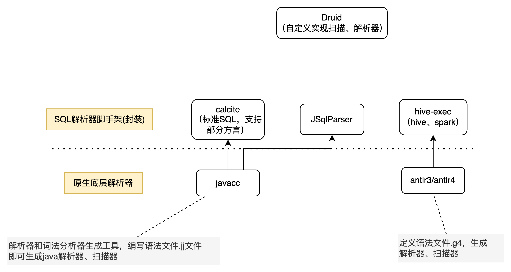
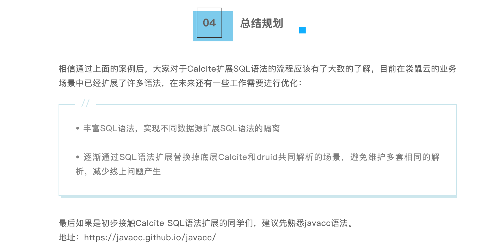
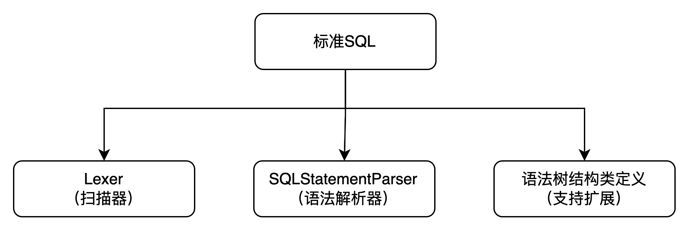
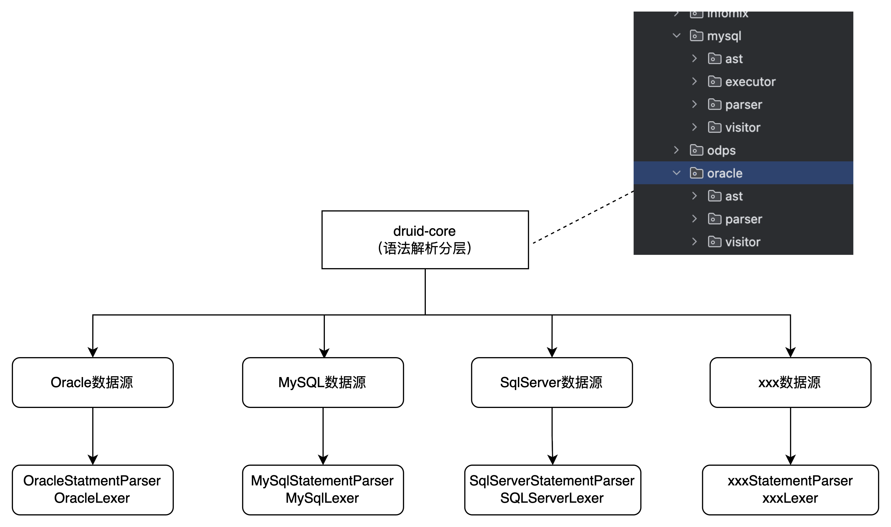
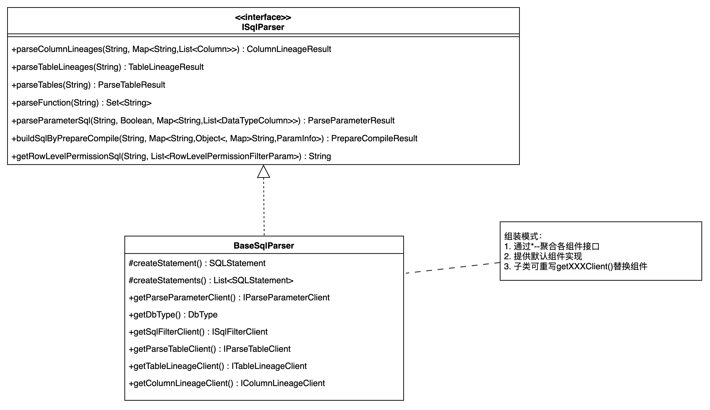
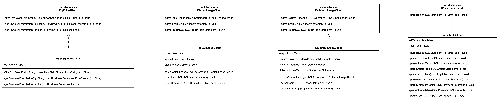
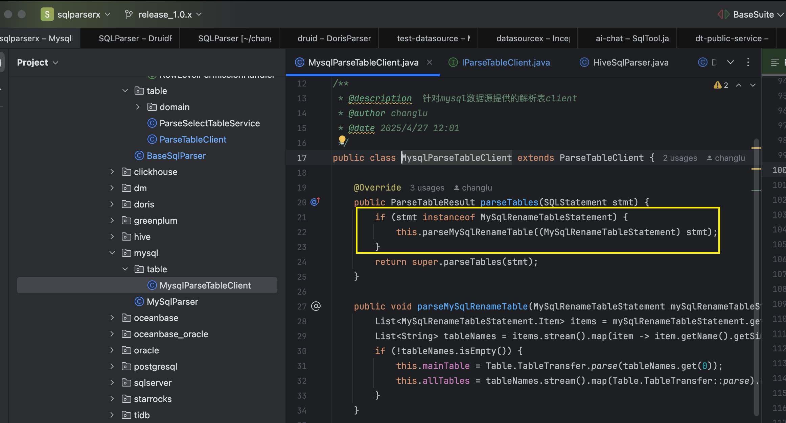
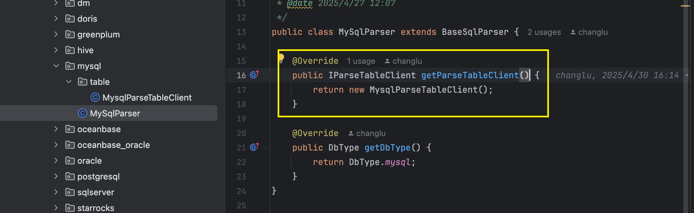
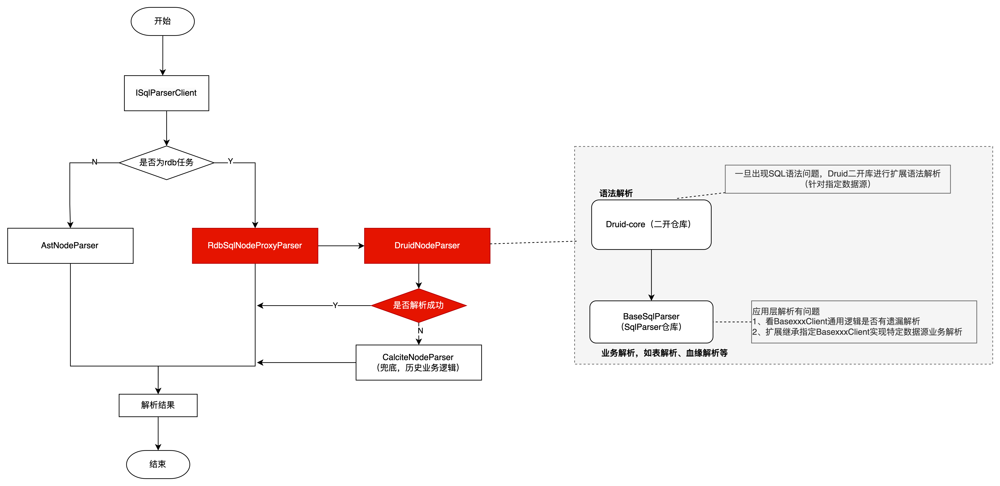
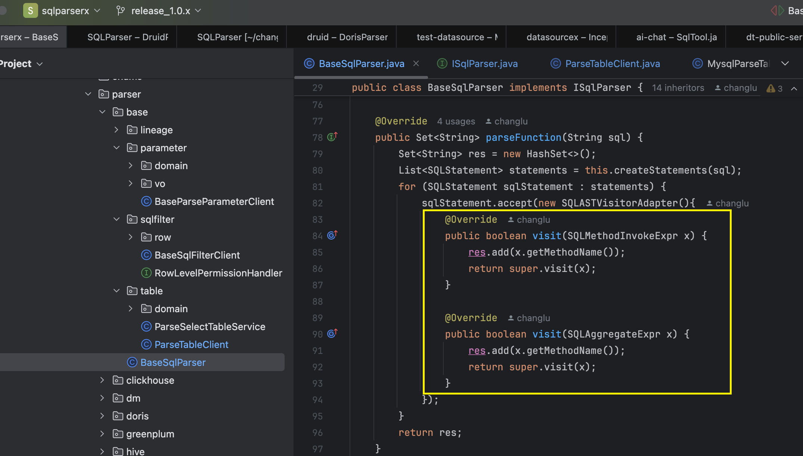

# SqlParserX 的诞生起源背景

> 作者：changlu ｜ 日期：2026-09-28
>
> 这是一篇关于 SqlParserX 起源的技术博客。它记录了从「为什么要做 SQL 解析」到「在大量异构数据源下如何统一解析」的思考过程，以及最终促成一个纯 Druid 实现的开源 SQL 解析项目诞生的背景。
> 项目地址与使用方式见根目录 [README](../../README.md)，双层架构设计见 [双层架构设计](../架构设计/架构设计.md)。

---

## 一、为什么需要懂解析器

### 1.1 什么是解析器

解析器是计算机科学和编程语言领域中至关重要的工具，其核心作用是**将人类可理解的「形式化语言」（如代码、数据格式、表达式等）转换为机器可处理的结构**，从而实现信息的解析、验证和后续处理。

人类使用的语言（无论是编程语言如 Python、数据格式如 JSON，还是查询语句如 SQL）本质是**结构化的字符串**，但机器无法直接理解这种字符串的逻辑含义。

例如，程序员写的 `x = (a + b) * 3` 是一串字符，但机器需要知道这是「先算 `a + b`，再乘以 3，最后赋值给 `x`」的运算逻辑。解析器把这个字符串解析为一棵语法树，再按规则一步步运算。

```sql
// 解析器 扫描解析方程 x = (a + b) * 3 得到的语法树 AST

        [=]
       /   \
     [x]   [*]
           /   \
         [+]   [3]
        /   \
      [a]   [b]

解释执行步骤：
1、从根节点 = 开始，表示这是一个赋值操作。
2、左子树 x 是赋值目标，右子树 * 是计算内容。
3、计算 * 时，先计算左子树 +（a + b），再乘以右子树 3。
4、最后将结果赋值给 x。
```

编程语言同理，如 C、Java 等都有特定的语法规则，通过解析器把代码转为 AST 语法树，再编译字节码、机器码来执行。

```sql
// 解析器 扫描解析 Java 代码 if (x > 0) { y = 10; } 得到的语法树 AST
       [if]
      /    \
   [>]    [block]
  /   \       \
[x]  [0]     [=]
            /   \
          [y]  [10]

解析执行步骤：
1、根节点 if 表示条件判断。
2、先计算条件 >（x > 0），如果为真：
3、进入 block 执行内部语句 y = 10。
4、如果为假，跳过整个 block。
```

**解析器的作用**，就是把这种字符串「拆解」为有意义的语法结构（如抽象语法树 AST），让机器能按规则执行。

### 1.2 如何实现解析器

在编译器实现中，主要要做的是**词法分析和语法分析**：

- **词法分析**：解析代码并生成 Token（一个单词的字面和它的种类及语义值）序列，实现一般称为扫描器（Scanner）。核心逻辑是定义 token（语义）与 scanner（扫描 token）。
- **语法分析**：利用扫描器生成的 Token 序列生成抽象语法树，实现一般称为解析器（Parser）。核心逻辑是进行语法检查，并构建由输入单词组成的层次化数据结构（语法分析树、抽象语法树等）。

```sql
数学表达式：1 + 2 * 3

// 首先在进行词法、语法分析前，我们先定义好 token
单词字面   Token 类型   说明
1          INTEGER     整数 1
+          ADD_OP      加法运算符
2          INTEGER     整数 2
*          MUL_OP      乘法运算符
3          INTEGER     整数 3

// 1、词法分析：从前往后扫描得到一组 Token 流
[INTEGER(1), ADD_OP(+), INTEGER(2), MUL_OP(*), INTEGER(3)]

// 2、语法分析：根据运算符优先级（* 优先于 +）和 Token 流构建 AST
      [+]
     /   \
    1    [*]
         /   \
        2     3
```

实现一种规则的解析器有两种方式：

- **方式一**：不依赖任何工具，手写扫描器和解析器。
- **方式二**：使用现成的解析器生成器（Yacc、ANTLR、JavaCC 等），根据自定义语法规则文件自动生成解析器代码，从而专注于语法规则设计。

### 1.3 什么是 SQL 解析器

SQL 解析器是**能够将 SQL 语句转换为计算机可理解和执行结构的程序组件**。它将文本形式的 SQL 转换为抽象语法树（AST），为后续的查询优化和执行提供基础。通俗地说，就是能对 SQL 进行解析、转换成语法树的工具。

```sql
# 查询
SELECT * FROM users WHERE status = 'active';
# 插入
INSERT INTO customers (name, email) VALUES ('李四', 'lisi@example.com');
# 更新
UPDATE products SET price = 5999 WHERE id = 1001;
# 删除
DELETE FROM logs WHERE create_time < '2024-01-01';
# 创建表
CREATE TABLE employees (id INT PRIMARY KEY, name VARCHAR(50), salary DECIMAL(10,2));
# 修改表
ALTER TABLE employees ADD COLUMN department VARCHAR(20);
# 删除表
DROP TABLE temp_data;
# 授权
GRANT SELECT ON customers TO user1;
```

### 1.4 SQL 解析位于整条链路的哪个位置

常见数据库执行 SQL 的整个过程：

```text
SQL文本 → 词法分析（Tokenizer）→ 语法分析（Parser）→ AST → 语义分析 → 优化SQL → 产生执行计划/执行任务
```

而 SQL 解析中间件关注的是 AST 之后的应用层能力：

```text
SQL文本 → 词法分析（Tokenizer）→ 语法分析（Parser）→ AST → 应用层（类型识别、表字段血缘、表解析、SQL脱敏）→ 子产品应用
```

**这正是 SqlParserX 的定位**：不重复实现数据库引擎，只基于一套统一的 AST，把「表、血缘、函数、权限改写」等解析能力做成可复用的中间件。

---

## 二、市面上常见的 SQL 解析方案

在动手之前，我们先横向比较了主流方案。



### 2.1 底层解析器件：JavaCC / ANTLR 3 / ANTLR 4

| 特性 | JavaCC | ANTLR 3 | ANTLR 4 |
|---|---|---|---|
| 语法分析算法 | LL(k) | LL(*) | LL(*)（自适应预测） |
| 左递归处理 | 不支持，需手动转换 | 需手动转换 | 自动处理 |
| 目标语言 | Java | Java、C#、Python 等 | 同 ANTLR 3 |
| 错误处理 | 基础错误恢复 | 增强的错误恢复 | 智能错误恢复与诊断 |
| 语法复杂度 | 简单直观 | 较复杂 | 简化（相比 ANTLR 3） |
| 应用场景 | 小型项目、教育 | 中大型项目 | 大型项目、复杂语法 |

### 2.2 SQL 解析器脚手架：Calcite / hive-exec

所谓脚手架，是基于 JavaCC 或 ANTLR 已经实现了标准 SQL 的词法、语法规则，我们只需按其规范扩展：

- **Calcite（基于 JavaCC）**：模块化、可扩展的 SQL 解析与优化框架，很多开源 SQL 引擎用它来做标准 SQL 解析与优化。
- **hive-exec（基于 ANTLR3）**：Hive 的核心包，支持 Hive/Spark 语法解析。

### 2.3 更「具象化」的解析器：JSqlParser / Druid

- **JSqlParser**：基于 JavaCC，能将 SQL 转为更语义化的结构（如 `select` → `SelectStatement`），支持语法树类继承、JavaAPI 构建 SQL、语法树转 SQL；但 **API 无明显的特定方言解析分层，支持的数据源解析能力较弱**。
- **Druid**：完全用 Java 自实现扫描器、解析器，解析出的语法树是**具象化的抽象语法树（具有继承关系）**，并且**支持按数据源分层扩展**（Lexer、Parser 扫描可分层隔离）。

### 2.4 核心对比与选型结论

| 工具 | 依赖工具 | 解析 SQL 能力 | 语法树类继承 | 优缺点 |
|---|---|---|---|---|
| JavaCC | 原生定义解析规则 | 无 | 无 | 需从零定义 SQL 规则 |
| ANTLR4 | 原生定义解析规则 | 有，官方语法生态极好 | 无 | 语法生态强，但解析语法树无抽象继承关系 |
| Calcite | 基于 JavaCC | 标准 SQL，多方言扩展、生态较弱 | 有 | 需手动扩展分层写语法规则，成本大 |
| hive-exec | 基于 ANTLR3 | 仅 Hive、Spark | 无 | 无法扩展分层到其他数据源 |
| JSqlParser | 基于 JavaCC | 标准 SQL，部分方言 | 有 | API 无明显数据源分层 |
| **Druid** | 原生 Java 实现扫描、解析器件 | 支持 MySQL、Oracle、Hive、Spark、Doris、StarRocks 等 | **有（极强）** | 数据源生态好、AST 有继承关系；缺点是 Java 自实现扫描器，入门有难度 |

面向数栈「大量异构数据源都要有同样继承关系的语法树」的场景，需要抽象定义统一的 `Insert`、`Select`、`Update`、`Delete` 等结构。

**基于 Druid 这样一套有继承关系的 AST，不同功能只需实现一套解析逻辑即可对应所有数据源，部分数据源再单独通过分层兼容即可。** 这成为后续选型的决定性理由。

### 2.5 为什么不直接用 ANTLR4

ANTLR4 生态确实很好（官方有 grammars-v4），但它的语法树**没有抽象继承关系**，难以在多数据源上沉淀「一套业务解析逻辑」，需要在业务层重新抽象一套结构，反而增加维护成本。Druid 的 AST 天然带继承体系，更契合我们的目标。

---

## 三、历史背景：改造前的 SQL 解析为什么难维护

### 3.1 子产品各自为战

改造前，SQL 解析散落在多个子产品中，各用各的方案：

```sql
离线 batchparser：SQL 类型识别、真实表解析、SQL 脱敏、行列级权限
  面向 SQL 类型：rdb（mysql、oracle、doris...）、hive、spark、impala
  实现：calcite & hive-exec 模块解析器，加上 druid 兜底【中间各种兼容语法正则匹配替换逻辑】

API apiparser：API 解析（预编译、非预编译）、真实表解析、行列级权限
  面向 SQL 类型：rdb
  实现：calcite + druid，druid 兜底

label labelparser：标签解析
  实现：calcite

实时 streamparser
  StreamCreateTableParser 直接使用正则匹配解析
  StreamCreateViewParser 使用 hive-exec 进行表、字段血缘解析
  StreamInsertParser 使用 FlinkPlanner & hive parser 进行表、字段血缘解析

资产 sqlparser：表、字段血缘解析、真实表解析、SQL 类型识别
  实现：比较混乱，calcite、druid 以及 hive parser 混用
```

核心问题是：**历史上针对 SQL 语法层面的扩展很少**，导致语法解析「一个不行就换另一个」，各种兜底；做过语法扩展的主要是基于 Calcite 扩展了少量语法（limit、starrocks 等）。

### 3.2 历史设计架构

改造前主要针对 Calcite（rdb 类型）、hive-exec（spark、hive）两类 SQL，Druid 与正则方式作为兜底。


业务逻辑可以分为两类：

**一类：SQL 类型识别、表解析、SQL 脱敏、行列级权限**

1. 根据 SQL 类型用 Calcite、hive-exec 解析得到语法树；
2. 基于语法树做上述业务。

**另一类：血缘实现**

1. 用 Calcite、hive-exec 解析得到语法树；
2. **自定义语法树**，实现两套转换器（Calcite AST → 自定义 AST、hive-exec AstNode → 自定义 AST）；
3. 针对自定义语法树写一套血缘解析逻辑。

> 问题：转换与解析扫描过程中，历史上曾出现死循环导致子产品服务挂掉等各种情况。



### 3.3 主要问题

1. **不同数据源语法解析扩展能力弱**：不同 rdb 语法需要正则前置处理，或单独去扩展语法，且扩展语法集中在一个模块；
2. **使用多种解析框架、各种兜底，代码维护难**：拿到语法树后的应用层解析逻辑也冗余在一起，到处是 `if` 判断数据源兼容逻辑，改一个地方可能影响其他地方，难以维护；
3. **血缘解析扩展弱、学习成本极高**：需要先了解 Calcite / AstNode 的节点定义，再具备自定义语法树能力，然后扩展两层转换逻辑（还容易死循环），最后才到血缘解析本身。

---

## 四、技术改造：双层分层

技术改造围绕两个层面分层：**语法解析层** 与 **业务解析层**。

### 4.1 语法解析层（基于 Druid）



分层实现后，扫描器、解析器都支持继承复用，且相互独立、互不影响，结构类可自定义扩展：



```java
// 工具类指定数据源类型实现解析
SQLStatementParser parser = SQLParserUtils.createSQLStatementParser(sql, DbType.doris);
SQLStatement statement = parser.parseStatement();

// 或直接 new 特定 Parser
DorisStatementParser statementParser = new DorisStatementParser(sql);
SQLStatement sqlStatement = statementParser.parseStatement();
```

### 4.2 业务解析层

- **解析层**：不同数据源 → 统一抽象结构语法树；
- **应用层**：针对统一 AST 实现一套解析方法；特定数据源在 AST 中自定义了部分节点时，应用层再针对该数据源的节点做分层处理。



针对抽象语法树实现通用解析组件：



后续扩展时，若在语法层单独实现了某个节点，只需继承 `BaseXxxClient`，单独实现差异方法即可，重复逻辑复用：



创建 Client 后，在对应 `XxxSqlParser` 中注册：



示例：

```java
// 准备 SQL
String sql = getSql();

// 1、获取解析器（工厂方式）
ISqlParser sqlParser = SqlParserFactory.getSqlParser(DbType.mysql);

// 2.1、解析表
ParseTableResult parseTableResult = sqlParser.parseTables(sql);
System.out.println(parseTableResult.getMainTable());   // 主表
System.out.println(parseTableResult.getAllTableName()); // 所有表

// 2.2、解析字段血缘（select * 场景可传入 tableColumnsMap 提供字段元数据）
ColumnLineageResult columnLineageResult = sqlParser.parseColumnLineages(sql, tableColumnsMap);

// 2.3、解析表血缘
TableLineageResult tableLineageResult = sqlParser.parseTableLineages(sql);

// 2.4、解析函数
Set<String> functions = sqlParser.parseFunction(sql);
```

### 4.3 改造后整体实现

后续语法解析、业务层解析都可独立扩展：



---

## 五、业务层解析的重新实现

历史上基于 Druid 的业务层实现很少（仅 API 解析、离线部分解析用 Druid 兜底），因此表解析、血缘解析都需要重新实现。

**有血缘特征的 SQL 类型**：`insert into/overwrite ... select`、`create ... select`、`with as ... insert`。

### 5.1 字段血缘解析

核心思路是**把来源与目标各自归一为一张二维表**。

以一条 `insert select` 为例：

```sql
insert into new_table (id, name)
select a.id as aid, b.name as bname
from old_table as a
left join old_table2 b on a.id = b.id
```

1. 拆成两个部分：`insert` 目标端、`select` 来源端；
2. 各自追溯得到一组列表：

```text
# 目标端
真实字段   别名字段   真实表名
  id        id       new_table
  name      name     new_table

# 来源端
真实字段   别名字段   真实表名
  id       aid       old_table
  name     bname     old_table2
```

3. 两组按固定规则匹配，即得字段血缘：

```text
# 第一条
admin 目标端 new_table.id  ←  来源端 old_table.id
# 第二条
目标端 new_table.name      ←  来源端 old_table2.name
```

来源端的「真实表名 → 来源表」「真实字段 → 来源字段」，目标端的「别名字段 → 目标字段」。

对于 `with as` 场景，每个 CTE 的 `()` 作为一组同样归一为二维表再匹配；对于**单列来源于多字段**的场景（如 `concat(t1.name, t2.name)`），真实字段与真实表名以 `,` 合并，最终拆成多条血缘。

### 5.2 表血缘解析

本质与字段血缘类似，更多是对表进行分组列表，一个 `select` 同样得到一组「表、表别名」的二维表，最终与 `insert` 目标表匹配即可完成表血缘。

### 5.3 表解析

与表血缘类似，需要解析出所有真实表；除了追溯真实表的过程，还要合并没有被追溯到的真实表，同时覆盖比表血缘更多的 SQL 结构（`select`、`update`、`delete`、`insert`、`drop`、`rename` 等）。

### 5.4 函数解析

函数与血缘无关，直接使用 **Visitor 模式**收集所有函数即可：



### 5.5 其他业务能力

- **SQL 脱敏（离线）**：复用字段血缘的 select column 组件拿到字段列表，再结合语法层位点能力进行改写；难点是 Druid 无精确原始 SQL 位点，需要扩展。
- **行级权限改写 SQL**：利用 Druid API 补充 AST 节点，再转回 SQL，本质是根据主体 select 封装/补充条件节点后重新输出。

---

## 六、SqlParserX 的诞生

在内部双层改造验证落地之后，一个更清晰的想法出现了：**能不能把「基于 Druid 的 SQL 解析」做成一个纯净、可独立演进的开源项目？**

于是有了 **SqlParserX** —— 一个无需依赖 Calcite、ANTLR 等其他解析组件，**完全基于 Druid 实现各类不同 SQL 解析**的开源项目。

### 6.1 双层架构

SqlParserX 将解析内核拆分为两个独立 Jar Module，结构对称、职责清晰：

```text
SqlParserX（根 Reactor）
├── sqlparserx-engine（聚合父模块，packaging=pom）
│   ├── sqlparserx-syntax（jar，语法解析层，基于 Druid）    ← 只管 SQL → AST
│   └── sqlparserx-core（jar，业务解析层，依赖 syntax）     ← 只管 AST → 业务结果
├── sqlparserx-web（HTTP 服务）
├── sqlparserx-mcp-server-sse（MCP Server）
└── sqlparserx-ui（前端）
```

- **语法解析层（`sqlparserx-syntax`）**：统一维护 Druid 依赖、SQL→AST、多语句解析与切分，以及后续数据源 Lexer / StatementParser / AST Node 扩展；
- **业务解析层（`sqlparserx-core`）**：基于统一 AST 实现真实表、建表结构、表/字段血缘、函数与 SQL 权限改写。

两层以 `DbType + SQLStatement AST` 作为连接契约，**不额外复制一套 AST**，避免长期转换与同步。详细设计见 [模块依赖包引用结构设计](../02、SQL业务层解析能力支撑情况/模块依赖包引用结构设计.md)。

### 6.2 从内部二开走向官方 Druid

项目早期依赖内部二开的 Druid 版本，随着能力沉淀，SqlParserX 已统一为**官方 Druid 1.2.28**，降低维护成本、方便社区协作。语法层坚持「**不在业务层用大量正则替换规避语法问题**」，方言语法差异一律回到语法层按 Druid 的方式扩展。

### 6.3 能力与文档体系

SqlParserX 不仅提供代码，也提供了一套可维护的文档体系：

- [双层架构设计](../架构设计/架构设计.md)
- [模块依赖包引用结构设计](../02、SQL业务层解析能力支撑情况/模块依赖包引用结构设计.md)
- [Druid 版本与 SQL 语法支持情况](../01、SQL语法层解析能力支撑情况/Druid版本与SQL语法支持情况.md)
- [能力支持情况（数据源 + 通用解析能力）](../02、SQL业务层解析能力支撑情况/能力支持情况/README.md)
- [解析能力标准迭代维护扩展指南](../02、SQL业务层解析能力支撑情况/标准迭代维护扩展文档/SqlParserX解析能力标准迭代维护扩展指南.md)

### 6.4 目标

- 无需依赖 Calcite、ANTLR 等其他解析组件，**完全基于 Druid** 实现各种数据源的 SQL 解析；
- **语法问题扩展 Druid，业务语义扩展 SqlParserX**；通用能力沉淀 Base，数据源差异按方言覆盖；
- 新增数据源时，语法差异在语法层扩展，业务差异在业务层扩展，上下两层通过 `DbType` 与 AST 对齐。

---

## 七、结语

从「散落各处的解析器 + 各种兜底」到「统一 AST + 双层分层」，再到「一个纯净、只依赖 Druid 的开源项目」，SqlParserX 的诞生不是一次性的重构，而是一次次把问题放回正确层次的取舍：

> **语法问题扩展 Druid，业务语义扩展 SqlParserX；通用能力沉淀 Base，数据源差异按方言覆盖。**

如果你在做多数据源的 SQL 解析、血缘、表解析相关工作，欢迎一起交流与共建。

---

> 作者：changlu ｜ 2026-09-28
>
> 本文图片位于 [`assets/`](assets/) 目录，仓库内以相对路径引用。
