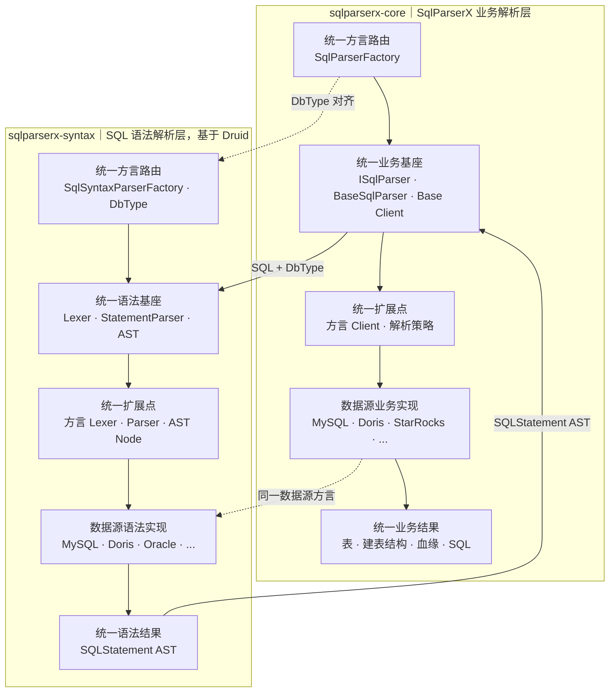

# SqlParserX 双层统一扩展架构

SqlParserX 的解析内核由两套相互衔接、结构对称的扩展体系组成，分别落在两个独立 Jar Module：

- **SQL 语法解析层（`sqlparserx-syntax`）**：基于官方 Druid，通过统一的方言路由、Parser 基座和 AST 模型，扩展不同数据源的 Lexer、StatementParser 与 AST Node。
- **SqlParserX 业务解析层（`sqlparserx-core`）**：通过统一的方言路由、`ISqlParser` 契约和业务 Client，扩展不同数据源的表解析、血缘解析与 SQL 改写逻辑。

两个模块由聚合父模块 `sqlparserx-engine`（`packaging=pom`）统一管理，模块依赖与包结构详见[模块依赖包引用结构设计](../02、SQL业务层解析能力支撑情况/模块依赖包引用结构设计.md)。

两层都遵循“**统一入口 → 通用基座 → 统一扩展点 → 数据源实现 → 统一结果**”的模式。新增数据源时，语法差异在 Druid 层扩展，业务差异在 SqlParserX 层扩展，上下两层通过 `DbType` 和 Druid AST 对齐。

架构图源文件：[SqlParserX两层架构.drawio](SqlParserX两层架构.drawio)，可直接预览的导出图如下。图中底部使用代表性厂商 Logo 展示数据源生态；Logo 仅表达可扩展的数据源方言范围，正式支持程度以能力支撑文档及回归测试为准。


## 总体架构



## 两层职责

| 统一扩展阶段 | SQL 语法解析层（`sqlparserx-syntax`） | SqlParserX 业务解析层（`sqlparserx-core`） |
|---|---|---|
| 统一方言路由 | `SqlSyntaxParserFactory` 按 `DbType` 选择对应语法方言 | `SqlParserFactory` 根据同一个 `DbType` 选择业务解析器 |
| 通用基座 | 通用 Lexer、StatementParser 和 AST | `ISqlParser`、`BaseSqlParser` 和 Base Client |
| 统一扩展点 | 方言 Lexer、方言 StatementParser、方言 AST Node | `IParseTableClient`、`IColumnLineageClient`、`ITableLineageClient`、解析策略等 |
| 数据源实现 | MySQL、Doris、Oracle、Hive 等 Druid 方言实现 | MySQL、Doris、StarRocks、Hive 等业务方言实现 |
| 统一结果 | `SQLStatement` AST | 表、建表结构、字段血缘、表血缘、函数及改写后的 SQL |

## SQL 语法解析层

语法解析层位于 `sqlparserx-syntax`，基于官方 Druid SQL Parser 实现。Druid 先提供统一的 Parser 和 AST 基座，再通过相同的方言分层方式扩展各数据源的 Lexer、StatementParser 和 AST 节点。Syntax 对 Core/Web 暴露统一语法契约 `SqlSyntaxParser`，所有 SQL→AST 操作都经由它完成。

```text
SQL + DbType
    → SqlSyntaxParserFactory
    → SqlSyntaxParser
    → SQLParserUtils
    → 方言 Lexer
    → 方言 StatementParser
    → SQLStatement AST
```

这一层只解决“SQL 是否能按指定数据源的语法被正确识别”。以下问题应在该层扩展：

- 新增或变更数据源关键字。
- SQL 在 Parser 阶段直接报语法错误。
- Druid 没有生成正确的 Statement 或表达式节点。
- 新语法需要新增 AST Node。
- 方言特有的 Lexer 或 StatementParser 行为。

语法扩展必须遵循 Druid 已有的数据源分层方式，不在业务层使用大量正则替换来规避语法问题。

## 业务解析层

业务解析层位于 `sqlparserx-core`，以 Druid AST 为解析基础。它复用与 Druid 语法层一致的分层思路：公共能力进入 Base，数据源差异进入对应方言实现，并最终返回统一业务模型。

```text
SqlParserFactory
    → ISqlParser
    → BaseSqlParser
    → 通用业务 Client
    → 数据源方言 Client（按需覆盖）
    → 统一业务结果模型
```

| 组成 | 主要职责 |
|---|---|
| `SqlParserFactory` | 根据 `DbType` 选择对应的数据源业务解析器 |
| `ISqlParser` | 定义表解析、血缘、函数、参数和 SQL 权限改写等统一入口 |
| `BaseSqlParser` | 生成或接收 AST，并将其分发给不同业务 Client |
| 通用 Client | 实现不同数据源可以共享的表解析、字段血缘、表血缘和 SQL 改写逻辑 |
| 方言 Client | 仅覆盖该数据源与通用逻辑不同的业务处理 |
| 结果模型 | 将 Druid AST 转换为稳定的表、字段、血缘和建表结构等业务对象 |

当前的数据源业务扩展示例：

| 数据源 | 业务层扩展 |
|---|---|
| MySQL | 补充 `RENAME TABLE` 的真实表识别 |
| StarRocks | 扩展 StarRocks 建表结构解析 |
| Doris | 扩展建表解析、字段大小写匹配及 CTE 前向引用血缘策略 |
| 其他数据源 | 默认复用 Base 实现，出现明确的业务差异时再覆盖相应 Client |

## 两层协作边界

| 现象 | 问题归属 | 处理位置 |
|---|---|---|
| SQL 无法解析或 AST 节点错误 | 语法解析层（`sqlparserx-syntax`） | 对应数据源的 Druid Lexer、Parser 或 AST |
| AST 正确，但表、字段或血缘结果错误 | 业务解析层（`sqlparserx-core`） | 通用 Client 或数据源方言 Client |
| 所有数据源都有相同问题 | 业务解析层通用逻辑 | `parser.base`、`select` 或公共工具 |
| 只有单个数据源的业务结果不同 | 业务解析层方言扩展 | `parser.<dialect>` 下对应能力 Client |

核心原则：**语法问题扩展 Druid，业务语义扩展 SqlParserX；通用能力沉淀 Base，数据源差异按方言覆盖。**

## 双层扩展示例

| 数据源变化 | SQL 语法解析层（`sqlparserx-syntax`） | SqlParserX 业务解析层（`sqlparserx-core`） |
|---|---|---|
| MySQL 新增一种 Statement | 扩展 MySQL StatementParser 和对应 AST Node | 根据新 AST 节点扩展 MySQL 业务 Client |
| Doris 新增建表语法属性 | 扩展 Doris CREATE TABLE 语法及 AST 属性 | 扩展 Doris 建表解析 Client，将属性转换为统一建表模型 |
| 某方言仅血缘规则不同 | Druid AST 已正确时无需修改 | 只扩展该方言的字段或表血缘 Client/策略 |

因此，一个数据源可以只复用两层的通用实现，也可以同时拥有"Druid 方言语法实现 + SqlParserX 方言业务实现"；两层扩展位置独立，但方言标识、AST 输入和数据源测试应保持一致。

## 模块依赖概览

```text
SqlParserX（根 Reactor）
├── sqlparserx-engine（聚合父模块，packaging=pom）
│   ├── sqlparserx-syntax（jar，基于 Druid）
│   └── sqlparserx-core（jar，依赖 syntax）
├── sqlparserx-web（依赖 core，直接使用语法 API 时显式依赖 syntax）
├── sqlparserx-mcp-server-sse（独立构建，依赖 core/syntax）
└── sqlparserx-ui（前端，仅通过 Web HTTP API 访问）
```

依赖方向约束：

- `sqlparserx-core` → `sqlparserx-syntax`：业务层通过 Syntax 获得 AST。
- `sqlparserx-syntax` 不得反向依赖 `sqlparserx-core`。
- Core/Web 不直接创建 Druid StatementParser，统一经由 `SqlSyntaxParser`。

完整的模块依赖规则、包结构和构建测试命令见[模块依赖包引用结构设计](../02、SQL业务层解析能力支撑情况/模块依赖包引用结构设计.md)。
