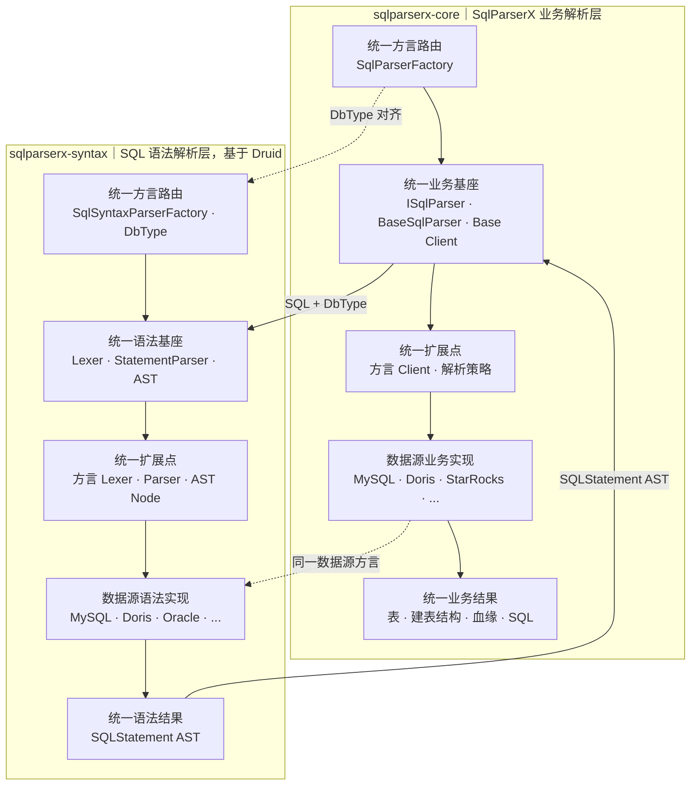

# SqlParserX 双层统一扩展架构

SqlParserX 的解析内核由两套相互衔接、结构对称的扩展体系组成，分别落在两个独立 Jar Module：

- **SQL 语法解析层（`sqlparserx-syntax`）**：基于官方 Druid，通过统一的方言路由、Parser 基座和 AST 模型，扩展不同数据源的 Lexer、StatementParser 与 AST Node。
- **SqlParserX 业务解析层（`sqlparserx-core`）**：通过统一的方言路由、`ISqlParser` 契约和业务 Client，扩展不同数据源的表解析、血缘解析与 SQL 改写逻辑。

两层都遵循“**统一入口 → 通用基座 → 统一扩展点 → 数据源实现 → 统一结果**”的模式。新增数据源时，语法差异在 Druid 层扩展，业务差异在 SqlParserX 层扩展，上下两层通过 `DbType` 和 Druid AST 对齐。


## 总体架构



## 两层职责

| 统一扩展阶段 | SQL 语法解析层（`sqlparserx-syntax`） | SqlParserX 业务解析层（`sqlparserx-core`） |
|---|---|---|
| 统一方言路由 | `SqlSyntaxParserFactory` 按 `DbType` 选择对应语法方言 | `SqlParserFactory` 根据同一个 `DbType` 选择业务解析器 |
| 通用基座 | 通用 Lexer、StatementParser 和 AST | `ISqlParser`、`BaseSqlParser` 和 Base Client |
| 统一扩展点 | 方言 Lexer、方言 StatementParser、方言 AST Node | `IParseTableClient`、`IColumnLineageClient`、`ITableLineageClient`、解析策略等 |
| 数据源实现 | MySQL、Doris、Oracle、Hive 等 Druid 方言实现 | MySQL、Doris、StarRocks、Hive 等业务方言实现 |
| 统一结果 | `SQLStatement` AST | 表、建表结构、字段血缘、表血缘、函数及改写后的 SQL |

## 模块依赖

```text
Access: sqlparserx-web (REST) / sqlparserx-ui
                 │ unified ISqlParser contract
Business layer:  sqlparserx-core
                 │ SQL + DbType / SQLStatement AST
Syntax layer:    sqlparserx-syntax (Druid 1.2.28)
```

业务扩展遵循 `SqlParserFactory` → `ISqlParser` → `BaseSqlParser` → 方言实现的模式。完整的模块依赖与包结构见 `sqlparserx-core` 模块的 README。