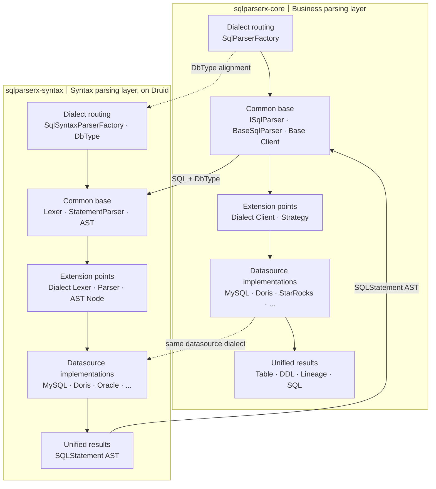

# Two-Layer Unified Extension Architecture

The SqlParserX parsing kernel consists of two connected, structurally symmetric extension systems, each in its own Jar module:

- **SQL syntax layer (`sqlparserx-syntax`)**: built on official Druid, extending Lexer, StatementParser and AST nodes per datasource through unified dialect routing, parser base and AST model.
- **SqlParserX business layer (`sqlparserx-core`)**: extending table parsing, lineage and SQL rewriting per datasource through unified dialect routing, the `ISqlParser` contract and business clients.

Both layers follow the pattern **unified entry → common base → unified extension point → datasource implementation → unified result**. When adding a datasource, syntax differences are extended in the Druid layer and business differences in the SqlParserX layer, aligned via `DbType` and Druid AST.


## Overall Architecture



## Module Dependencies

```text
Access: sqlparserx-web (REST) / sqlparserx-ui
                 │ unified ISqlParser contract
Business layer:  sqlparserx-core
                 │ SQL + DbType / SQLStatement AST
Syntax layer:    sqlparserx-syntax (Druid 1.2.28)
```

Business extensions follow `SqlParserFactory` → `ISqlParser` → `BaseSqlParser` → dialect implementations.